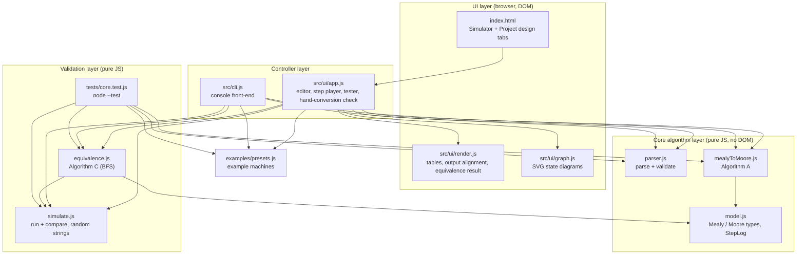
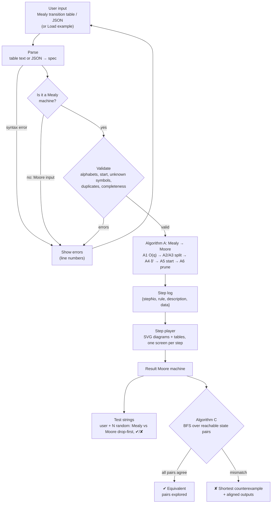
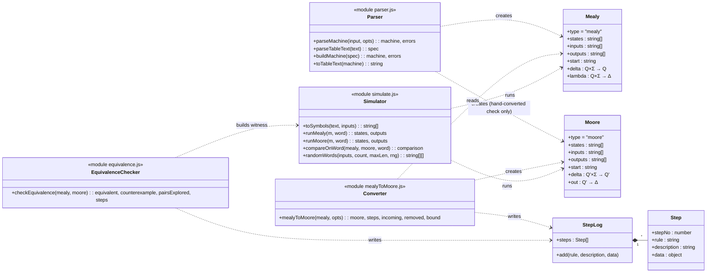
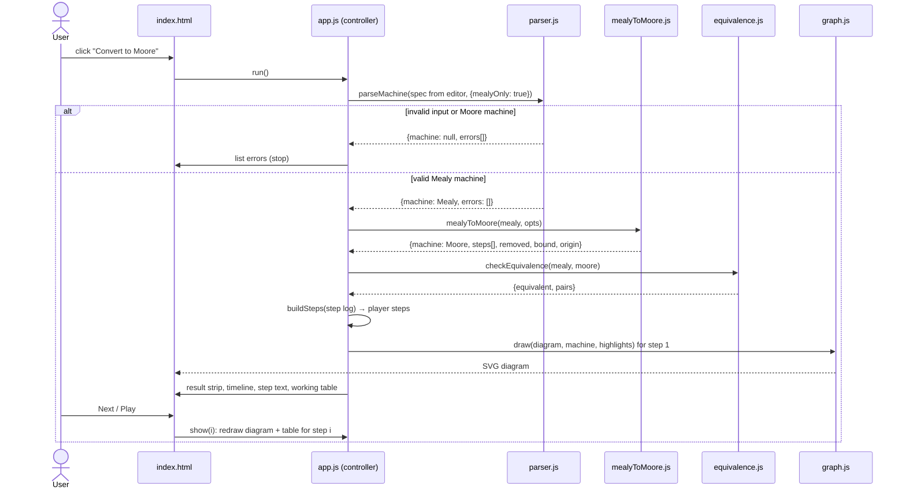
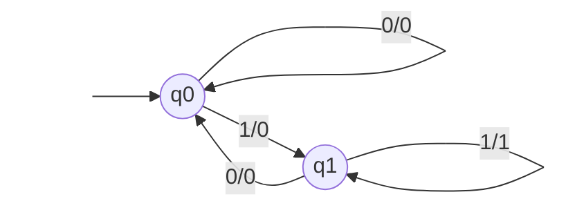
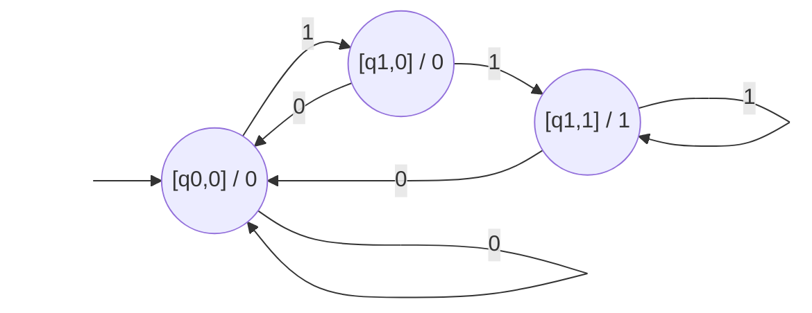
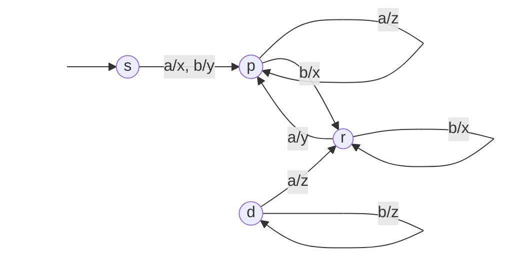
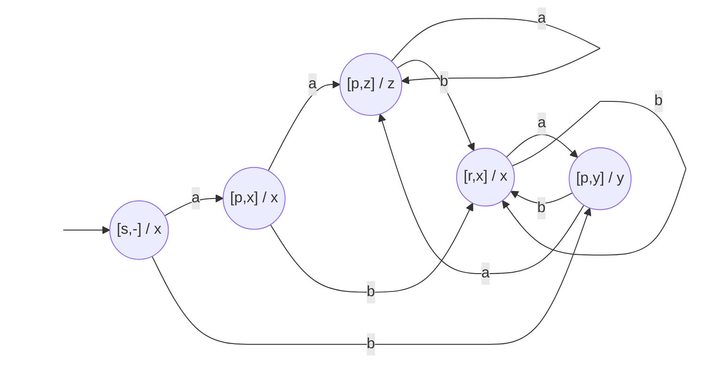

# Mealy → Moore Machine Conversion Simulator

**CSET302 – Automata Theory and Computability** · 3rd Year B.Tech · 2026
**Milestone-1: Simulator Design Review** (evaluation window 2–6 November 2026)
**Topic #14** from the official topic pool. Project scope: *Mealy → Moore conversion, preserving and displaying output behaviour.*

| # | Name | Enrollment No. |
|---|------|----------------|
| 1 | Sumukh Gupta | S24CSEU0570 |
| 2 | Neya Tripathi | S24CSEU0609 |
| 3 | Aaditya Goel | S24CSEU0614 |
| 4 | Kushika Mishra | S24CSEU0652 |
| 5 | Kartik Mahajan | S24CSEU0640 |

**Date:** 4 November 2026

---

## Contents

1. Problem Statement & Objectives
2. Theoretical Specification
3. Inputs & Outputs of the Simulator
4. Analysis of Existing Tools
5. Feasibility Study
6. System Architecture
7. Methodology & Workflow
8. UML
9. Module Description
10. UI Wireframe
11. Algorithms
12. Manually Validated Examples
13. Preliminary Prototype
14. Test Plan for M2
15. Individual Contributions & Work Plan to M2
16. Limitations & Future Scope
17. References

Rubric map: §1–3 → *Problem Definition & Automata Specification*; §4–5 → *Existing Tools & Feasibility*; §6–10 → *Simulator Design & Methodology*; §11–13 → *Algorithm Selection & Correctness*.

---

## 1. Problem Statement & Objectives

**Problem.** Mealy and Moore machines are the two standard models of finite-state transducers. Textbooks prove that the two models are equivalent, but students usually see the conversion only as a finished table. They rarely see *why* a Mealy state must be split, *which* copy should be the start state, or *how* to check that the converted machine really behaves the same. A hand conversion can also be wrong in ways that a few test strings miss.

**Goal.** Build a browser-based simulator that takes a user-defined Mealy machine and converts it to an equivalent Moore machine. It shows every intermediate step with the rule applied, displays both machines as tables and state diagrams, and **proves** that the result is equivalent with an exact algorithm that returns a counterexample when it is not.

**Measurable objectives**

| ID | Objective | Measure of success |
|----|-----------|--------------------|
| O1 | Accept any user-defined deterministic, complete Mealy machine | Machines entered as transition-table text or JSON; every invalid input from §3.3 produces a specific error message (tested in `tests/core.test.js`) |
| O2 | Correct Mealy → Moore conversion (state splitting) | Reproduces the hand-worked Examples 1 and 2 exactly (§12); passes the equivalence check |
| O3 | Step-by-step explanation | Every created state, transition and choice appears as a numbered step `{stepNo, rule, description, data}` |
| O4 | Visualization | Transition tables and state diagrams for the input Mealy and output Moore machines, side by side |
| O5 | Exact validation | BFS equivalence check over reachable state pairs; returns a *shortest* counterexample on failure |
| O6 | Supplementary validation | Run user strings and N random strings on both machines with a per-symbol ✔/✘ comparison |
| O7 | Zero-install | Runs in a browser from a static folder; core algorithms unit-tested with Node's built-in runner |

---

## 2. Theoretical Specification

### 2.1 Formal models

**Mealy machine** M = (Q, Σ, Δ, δ, λ, q0)

- Q: finite, non-empty set of states
- Σ: finite, non-empty input alphabet
- Δ: finite, non-empty output alphabet
- δ: Q × Σ → Q, the transition function (total, deterministic)
- λ: Q × Σ → Δ, the output function. **Output is attached to transitions.**
- q0 ∈ Q: the start state

On input w = a1 a2 … an the machine visits q0, q1, …, qn with qi = δ(qi−1, ai) and emits **n** symbols λ(q0,a1) λ(q1,a2) … λ(qn−1,an).

**Moore machine** M' = (Q', Σ, Δ, δ', λ', q0')

- δ': Q' × Σ → Q', the transition function (total, deterministic)
- λ': Q' → Δ, the output function. **Output is attached to states.**

On the same input it visits q0', q1', …, qn' and emits **n + 1** symbols λ'(q0') λ'(q1') … λ'(qn').

Both machines in this project are **deterministic and complete**: δ (δ') is defined exactly once for every (state, symbol) pair. The parser rejects anything else (§3.3).

### 2.2 Output-equivalence convention

A Moore machine emits λ'(q0') before reading anything, the output for the empty prefix ε. A Mealy machine emits nothing for ε. So the two output strings always differ in length by one, and we adopt the standard convention:

> **M and M' are equivalent iff for every w ∈ Σ\*, the Moore output of w with its first symbol dropped equals the Mealy output of w.**
> Formally: λ'(δ'\*(q0', u·a)) = λ(δ\*(q0, u), a) for every u ∈ Σ\*, a ∈ Σ.

The same sentence appears in the UI header, and the test-string table shows the dropped symbol greyed out.

### 2.3 Why the Moore machine has one extra output

A Moore output is a function of the *state*, and the machine is in some state before reading any input. That state's output is emitted for ε. A Mealy output is a function of a *transition*, and there is no transition before the first symbol. The extra symbol therefore carries no information about the input. That is why it is dropped, and why any choice of start copy works in Algorithm A (§11.1, step A5).

### 2.4 Why state splitting is needed (Mealy → Moore)

In a Moore machine the output depends only on the state you are in. In a Mealy machine, a state q may be *entered* by transitions emitting different outputs. In Example 1, q1 is entered by q0 --1/0--> q1 and by q1 --1/1--> q1. A single Moore state for q1 cannot emit both 0 and 1. So q1 is split into one copy per output that enters it, [q1,0] and [q1,1]. Each copy remembers "I am q1 and the last output was o". The copies have identical outgoing behaviour because they come from the same Mealy state, so splitting adds memory of the last output without changing what the machine computes.

---

## 3. Inputs & Outputs of the Simulator

### 3.1 Inputs

| Input | Format | Constraints |
|-------|--------|-------------|
| Mealy machine | **Editor form**: Q, Σ, Δ as comma-separated lists, start state, and a table with a next-state and an output drop-down per cell. **Or import** transition-table text / JSON (paste anything starting with `{`). *Load an example* fills the form | Must be a Mealy machine (`type: mealy`); deterministic, complete (both parts of every cell filled); see §3.3 |
| Default output | Drop-down over Δ (default: first symbol of Δ) | Used only for states with no incoming transitions |
| Start copy [q0,o] | Drop-down over Δ (default: first o ∈ O(q0) in Δ order) | Must be in O(q0); ignored when q0 has no incoming transitions |
| Remove unreachable | Checkbox (default on) | |
| Test string | One string, or a *Try* sample; empty or `ε` = empty string. Single-character alphabets: `0111`; multi-character symbols separated by spaces | Every symbol must be in Σ |
| Random test | *20 random* button | Lengths uniform in 0–8 |
| Hand-converted Moore machine (optional) | Same formats, `type: moore` | Must be a Moore machine; checked against the input Mealy machine by Algorithm C |

**Transition-table text** (`#` starts a comment). The Mealy format (left) is the main input. The Moore format (right) is used only for the optional hand-converted machine in the *Check a hand-converted Moore machine* panel.

```
type: mealy                     type: moore
start: q0                       start: [q0,0]
outputs: 0 1                    outputs: 0 1
state | 0    | 1                state  | out | 0      | 1
q0    | q0/0 | q1/0             [q0,0] | 0   | [q0,0] | [q1,0]
q1    | q0/0 | q1/1             [q1,0] | 0   | [q0,0] | [q1,1]
                                [q1,1] | 1   | [q0,0] | [q1,1]
```

The header row gives Σ, the first column gives Q, and Mealy cells are `next/output`.

**JSON** (the format of the examples in `examples/presets.js`):

```json
{ "type": "mealy", "states": ["q0","q1"], "inputs": ["0","1"], "outputs": ["0","1"], "start": "q0",
  "transitions": [ {"from":"q0","input":"0","to":"q0","output":"0"}, ... ] }
```

A Moore JSON spec (hand-converted machine only) omits `output` in transitions and adds `"stateOutputs": {"[q0,0]":"0", ...}`.

### 3.2 Outputs

| Output | Description |
|--------|-------------|
| Validation errors | Every problem in the input, one message each, with line numbers for text syntax errors |
| Step log | Numbered list of `{stepNo, rule, description, data}`; rules A1–A6, BOUND (Algorithm A) |
| Machines | Input Mealy and output Moore transition tables (start marked →) and state diagrams, side by side |
| State-count report | \|Q'\| created, removed, final, and the bound \|Q\|·\|Δ\| |
| Test results | For each string: Mealy output, Moore output, Moore output with first symbol dropped, per-symbol alignment grid, ✔/✘ |
| Equivalence verdict | ✔ with the number and list of reachable pairs explored, or ✘ with a shortest counterexample and both outputs |

### 3.3 Validation rules (all reported together, not only the first)

| Error | Example message |
|-------|-----------------|
| Empty Q / Σ / Δ | `Input alphabet Σ is empty: declare at least one element in "inputs"` |
| Duplicate state or symbol | `State set Q has duplicate entries: q0` |
| Undefined start state | `Start state is undefined: set "start"` / `Start state "q9" is not in Q = {q0, q1}` |
| Unknown input symbol | `Transition #1 (q0, 2): unknown input symbol "2" (Σ = {0, 1})` |
| Unknown output symbol | `Transition #1 (q0, 0): unknown output symbol "7" (Δ = {0, 1})` |
| Unknown state | `Transition #2 (q0, 1): target state "q5" is not in Q` |
| Duplicate transition (non-determinism) | `Duplicate transition: δ(q0, 0) is defined more than once (machine must be deterministic)` |
| Missing transition (incomplete) | `Missing transition: δ(q1, 1) is not defined (machine must be complete)` |
| Moore state without output | `Missing state output: λ'(r2) is not defined` |
| Moore machine as main input | `Input must be a Mealy machine (this simulator converts Mealy → Moore only)` |
| Unknown type | `"type" must be "mealy" or "moore"` |
| Malformed text / JSON | `Line 3: cell "q0" must be written as next/output`; JSON syntax error message |

---

## 4. Analysis of Existing Tools

Each capability below was checked against the tool's own documentation or README. Links are in §17. Anything we could not confirm is marked **[to verify]**.

| Tool | Mealy | Moore | Mealy → Moore conversion | Shows intermediate steps | Equivalence check | Platform | Limitations |
|------|:-----:|:-----:|:------------------------:|--------------------------|:-----------------:|----------|-------------|
| **JFLAP 7.1** [1][2][3] | ✔ build, step, fast run, multiple run | ✔ build, step, fast run, multiple run | ✘ not offered (the tutorial index lists conversions for FA, PDA, TM and grammars, but none for Mealy/Moore) | Steps through an *input string* (output tape); no conversion steps | ✘ not mentioned | Java desktop application (download + JRE) | No conversion between the two models; install required; nondeterministic Mealy/Moore machines cannot be run |
| **automatonsimulator.com** (kdickerson/automatonSimulator) [4] | ✘ (README lists DFA, NFA, PDA only) | ✘ | ✘ | Step-debugs a string on an acceptor | ✘ | Browser | Acceptors only, no transducers. That the live site runs this repository's code is **[to verify]** |
| **Noam FSM Simulator** (Ivan Zuzak) [5] | ✘ (DFA, NFA, eNFA only) | ✘ | ✘ | Steps one input symbol at a time | ✘ | Browser | Acceptors only; sister tool FSM2Regex converts between FSMs and regexes, not Mealy → Moore |
| **Moore-Mealy-Converter** (GitHub, alimurtazaathar) [6] | ✔ | ✔ | ✔ both directions | **[to verify]** (README describes only the input and generated machines) | ✘ not mentioned | Python 3 desktop (Tkinter, NetworkX, Matplotlib) | Install required; no documented step log or validation |
| **Tutorial sites** (GeeksforGeeks, Educative, TpointTech, Naukri Code360) [7][8][9] | n/a | n/a | Worked examples by hand | ✔ static, pre-written | ✘ | Web pages | Not interactive: cannot enter your own machine or test strings |

**Identified gap.** No tool we could verify combines all three:
(1) **step-by-step Mealy → Moore conversion** with the rule behind each step (including the start-state choice and states with no incoming transitions),
(2) **exact equivalence verification** that returns a **shortest counterexample**, which also lets a student check their *own* hand conversion, and
(3) **zero installation**: it runs in any browser.

Our simulator targets exactly this gap.

---

## 5. Feasibility Study

**Technical feasibility.** The algorithms are small: polynomial, table-driven, with no search beyond BFS. The stack is plain HTML/CSS/JavaScript with no libraries, CDN, server or build step: `index.html` opens by double-clicking, so it works in the lab offline. State diagrams are drawn as SVG by our own `graph.js`. Each core file is a plain script that also loads in Node, so unit tests use Node's built-in `node --test` with no npm dependencies. The prototype in §13 already shows every core piece working.

**Schedule feasibility.**

| Date | Milestone | Status |
|------|-----------|--------|
| 18 Sep 2026 | Group + topic finalised | done |
| 2–6 Nov 2026 | **M1**: design + algorithms + prototype | this document; prototype working |
| 7–22 Nov 2026 | M2 build-out (§15) | planned |
| 23–27 Nov 2026 | **M2**: demo, report, tests | planned |

About three weeks remain between M1 and M2 for features that are mostly UI and testing. The algorithm core, which is the risky part, is finished.

**Team-skill feasibility.** All members have completed programming and data-structures courses (JavaScript/HTML basics, BFS, hash maps). The core modules are each under about 150 lines with JSDoc, so every member can read and explain any module (§9 assigns owners).

**Complexity analysis.** Let n = |Q|, m = |Δ|, k = |Σ|, n' = |Q'|.

| Operation | Time | Space | Note |
|-----------|------|-------|------|
| Parse + validate | O(n·k + \|T\|) | O(n·k) | T = listed transitions |
| Algorithm A (Mealy → Moore) | **O(n·m·k)** | O(n·m·k) | n' ≤ n·m states, each with k transitions; pruning BFS is O(n'·k) |
| Algorithm C (equivalence) | **O(n·n'·k)** | O(n·n') | at most n·n' reachable pairs, k checks each |
| Simulate a word of length L | O(L) | O(L) | |

For any realistic classroom machine (≤ 20 states) all operations run in well under a millisecond. The whole test suite, including 600 random-string comparisons, finishes in under 0.4 s.

---

## 6. System Architecture

Four layers. The two lower layers are **pure JavaScript with no DOM access**, so the same code runs in the browser, in the CLI, and in the unit tests.



Source: `docs/diagrams/architecture.mmd`.

**Design decisions**

- **Single trust boundary.** Only `parser.js` checks input. The algorithms assume a valid, complete, deterministic machine, which keeps them short and readable.
- **Structured step log.** Algorithms return data (`{stepNo, rule, description, data}`), not HTML. The UI's step player only replays these records (one screen per step, with the affected states, edges and table cells highlighted), so the algorithms never touch the page.
- **Plain scripts, no server.** Every core file is wrapped so that it adds its functions to `window.MM` in the browser and exports them with `module.exports` in Node. The same files run in the page (opened from `file://`), the CLI and the tests.

---

## 7. Methodology & Workflow

The workflow follows the course's Minimum Technical Standard: **User Input → Algorithm → Step-by-Step Processing / Visualization → Result → Validation**.



Source: `docs/diagrams/workflow.mmd`.

**Development methodology.** We build bottom-up and test first. Core algorithms come first, then unit tests that encode the hand-worked examples, then the UI. A feature counts as done only when its hand-worked expected result and the program output agree (§12).

---

## 8. UML

### 8.1 Class diagram

The core is written as plain-script modules of pure functions. In the diagram each module appears as a class with a `<<module>>` stereotype; `Mealy`, `Moore`, `StepLog` and `Step` are the data types.



Source: `docs/diagrams/class.mmd`.

### 8.2 Sequence diagram: user clicks *Convert* (Mealy → Moore)



Source: `docs/diagrams/sequence_convert.mmd`.

---

## 9. Module Description

Owners are the members accountable for each module and its viva questions. Every member must still be able to explain the whole pipeline (§9 of the course plan).

| Module | Responsibility | Inputs | Outputs | Owner |
|--------|----------------|--------|---------|-------|
| `src/core/model.js` | Type definitions (JSDoc) for Mealy/Moore, `StepLog`, `splitName`, `showWord` | – | shared types/helpers | Sumukh Gupta |
| `src/core/parser.js` | Parse table text / JSON; validate (§3.3); reject Moore machines as main input; serialise back to table text | text or object | `{machine, errors}` | Neya Tripathi |
| `src/core/mealyToMoore.js` | **Algorithm A**: state splitting, start choice, pruning, bound | Mealy machine, options | `{machine, steps, incoming, removed, createdCount, bound, origin}` | Sumukh Gupta |
| `src/core/simulate.js` | Run either machine, compare under the convention, random words | machines, word | traces, `{match, mooreDropped, …}` | Aaditya Goel |
| `src/core/equivalence.js` | **Algorithm C**: BFS over state pairs, shortest counterexample | Mealy, Moore | `{equivalent, counterexample, pairsExplored, pairs, steps, witness}` | Aaditya Goel |
| `src/ui/app.js` | Controller: editor, options, turns the step log into player steps, step player, tester, hand-conversion check | DOM events | calls core, updates the page | Sumukh Gupta |
| `src/ui/graph.js` | Draws a Mealy or Moore machine as an SVG state diagram (layered layout, highlights, colours) | machine, highlight options | SVG | Kushika Mishra |
| `src/ui/render.js`, `style.css`, `index.html` | Transition tables, output alignment, equivalence result; layout and style; design-document tab | core results | HTML | Kushika Mishra |
| `examples/presets.js` | Example machines (JSON spec format) with notes and sample strings | – | preset list | Neya Tripathi |
| `src/cli.js` | Console front-end used for evidence (§13) | preset id or file + words | text report | Kartik Mahajan |
| `tests/core.test.js` | Unit tests for Examples 1–2, edge cases, invalid inputs | – | pass/fail | Neya Tripathi |
| `docs/*` | Design doc, diagrams, slides | – | – | Kartik Mahajan (lead), all |

*Ownership above is the team's proposed split; adjust it here if the actual division differs.*

---

## 10. UI Wireframe

The low-fidelity wireframe is in the **Project design (Milestone 1)** tab of `index.html`; the **Simulator** tab is the working prototype of it. Regions:

| Region | Content | Behaviour |
|--------|---------|-----------|
| **Header** | Title, *Simulator* / *Project design* tabs, *Hide editor* | Tabs switch pages; *Hide editor* (or `F`) gives the diagram the full width |
| **Editor** (left) | *Load an example* + *New*, Q, Σ, Δ, start state, δ / λ table (two drop-downs per cell), *Import a transition table or JSON*, options (default output, start copy, remove unreachable), **Convert to Moore**, message box | Convert validates input (a Moore machine is rejected); errors stop processing and are listed in red |
| **Result strip + timeline** | States Mealy → Moore, states created, unreachable removed, bound \|Q\|·\|Δ\|, ✓ equivalent; phases Input → Incoming outputs → Split states → Transitions → Start state → Unreachable → Result → Validate | Click a phase to jump to its first step |
| **Step player** | ⏮ ◀ Prev ▶ Play Next ▶ ⏭, speed, progress bar, step title and explanation | One screen per step of the structured step log; `←` `→` `Space` keys |
| **Diagram + working area** | SVG state diagram on graph paper; working table for the current phase (O(q) table, created states, δ′ table filling in, start candidates, reachable/removed, before/after tables, explored pairs) | Affected states, edges and cells highlighted in amber |
| **String tester** | String box, *Run on both*, *20 random*, *Try* samples | Both state paths, per-symbol alignment (dropped Moore symbol greyed, mismatches red), log table with ✓/✗ |
| **Hand-conversion check** | Box: "paste your own hand-converted Moore machine to check it", **Verify equivalence**, *Copy generated Moore machine into the box* | ✓ with pairs explored, or ✗ with shortest counterexample and aligned outputs |
| **All steps** | Every step grouped by phase | Click a step to jump to it |

[SCREENSHOT: Project design tab, UI wireframe section]

---

## 11. Algorithms

Notation: O(q) = set of outputs on transitions entering q; [q,o] = Moore state for "Mealy state q, entered with output o"; [q,−] = the single copy of a state with no incoming transitions.

### 11.1 Algorithm A: Mealy → Moore (state splitting)

```
MEALY-TO-MOORE(M = (Q, Σ, Δ, δ, λ, q0), def = Δ[0], startOut = none, prune = true)
 1  for each q ∈ Q: O(q) ← ∅
 2  for each q ∈ Q, a ∈ Σ: O(δ(q,a)) ← O(δ(q,a)) ∪ {λ(q,a)}            ▷ A1
 3  Q' ← ∅
 4  for each q ∈ Q:
 5      if O(q) = ∅: add [q,−] to Q';  λ'([q,−]) ← def                  ▷ A3
 6      else for each o ∈ O(q): add [q,o] to Q';  λ'([q,o]) ← o          ▷ A2
 7  for each [q,o] ∈ Q', a ∈ Σ:
 8      δ'([q,o], a) ← [δ(q,a), λ(q,a)]                                  ▷ A4
 9  if O(q0) = ∅: q0' ← [q0,−]                                           ▷ A5
10  else q0' ← [q0, startOut or first of O(q0)]
11  if prune: Q' ← states reachable from q0' by BFS over δ'               ▷ A6
12  return M' = (Q', Σ, Δ, δ', λ', q0')                                  ▷ BOUND: |Q'| ≤ |Q|·|Δ|
```

**Line-by-line**

- **1–2 (A1).** Scan every transition once. The output λ(q,a) is added to the set of the *target* δ(q,a), because a Moore state's output must describe how it was *entered*.
- **4–6 (A2/A3).** Each Mealy state becomes one Moore state per entering output. A state with no incoming transitions (only possible for q0 or an unreachable state) still needs a Moore copy, so we create [q,−] with a user-selectable default output. This is logged with `defaulted: true`.
- **7–8 (A4).** From [q,o] on a, the Mealy machine goes to p = δ(q,a) and emits b = λ(q,a). The Moore machine goes to [p,b], whose state output is b. **The target always exists** because line 2 put b into O(p). The transition does not depend on o, so all copies of q behave identically.
- **9–10 (A5).** If q0 has no incoming transitions, its only copy is the start. Otherwise any copy [q0,o] works (proof below). We pick the first in Δ order, or the user's choice.
- **11 (A6).** States can be unreachable: copies of unreachable Mealy states, or a copy [q,o] whose output o enters q only from an unreachable state (Example 2, [r,z]). We remove them and list them.
- **12 (BOUND).** Each q contributes max(1, |O(q)|) ≤ |Δ| states, so |Q'| ≤ |Q|·|Δ|. Some textbook variants add a fresh start state with an extra output and so state the bound as |Q|·|Δ| + 1 [9]. Our construction never adds a fresh state, so |Q|·|Δ| holds.

**Correctness (invariant).** Claim: for every input u, if the Mealy machine is in state q after reading u, then the Moore machine is in some copy [q,·]. When u = u'a with |u| ≥ 1, that copy is exactly [q, b] where b is the last Mealy output.
*Base (u = ε):* the Moore machine is in q0' = [q0,·]. *Step:* the Moore machine is in [q,o] and the Mealy machine in q. On a, Moore moves to [δ(q,a), λ(q,a)] (line 8) and Mealy moves to δ(q,a), emitting λ(q,a). The invariant holds, and the Moore output λ'([δ(q,a), λ(q,a)]) = λ(q,a) equals the Mealy output for that symbol.
So Moore output position i+1 equals Mealy output position i for every i ≥ 1, which is exactly the convention of §2.2. Only position 0, λ'(q0'), depends on the start choice, and it is dropped. **Hence every choice of start copy and every default output gives an equivalent machine.** Pruning removes only states that no input reaches, so it cannot change any output.

**Complexity.** Lines 1–2: O(|Q|·|Σ|). Lines 7–8: |Q'|·|Σ| ≤ |Q|·|Δ|·|Σ|. Line 11: O(|Q'|·|Σ|). Total **O(|Q|·|Δ|·|Σ|)**.

### 11.2 Algorithm C: exact equivalence check (formal validation)

```
EQUIVALENT(M = (Q, Σ, Δ, δ, λ, q0), M' = (Q', Σ, Δ, δ', λ', q0'))
 1  require Σ(M) = Σ(M')
 2  parent[(q0, q0')] ← nil;  queue ← [(q0, q0')]
 3  while queue not empty:
 4      (q, r) ← dequeue(queue)
 5      for each a ∈ Σ:
 6          p ← δ(q,a);  s ← δ'(r,a)
 7          if λ(q,a) ≠ λ'(s):
 8              return NOT EQUIVALENT, counterexample = path(q, r) · a      ▷ C-FAIL
 9          if (p, s) ∉ parent:
10              parent[(p, s)] ← ((q, r), a);  enqueue(queue, (p, s))
11  return EQUIVALENT                                                     ▷ C-OK
```

`path(q, r)` follows `parent` pointers back to (q0, q0') and collects the symbols.

- **2.** A pair (q, r) means "after some input u, Mealy is in q and Moore is in r".
- **6–8.** On a, the Mealy machine emits λ(q,a) and the Moore machine emits λ'(δ'(r,a)). Under the convention these must be equal. If they differ, u·a is a concrete input on which the outputs differ.
- **9–10.** Each reachable pair is explored once. `parent` records how it was reached, so the counterexample can be rebuilt.

**Why it is sound and complete.** (i) *Every input prefix corresponds to a reachable pair.* Both machines are deterministic, so each u ∈ Σ\* leads to exactly one pair (δ\*(q0,u), δ'\*(q0',u)), and that pair is reachable by construction. (ii) *The pair space is finite:* at most |Q|·|Q'| pairs, so the BFS terminates. (iii) The convention requires λ(δ\*(q0,u), a) = λ'(δ'\*(q0', ua)) for all u, a. That is exactly the check on line 7 for the pair of u and symbol a. So if the BFS finishes, *every* position of *every* input agrees, and the machines are **equivalent**. If it stops at line 8, the returned word is a real witness, which the prototype re-simulates and displays. (iv) *Shortest counterexample:* BFS processes pairs in non-decreasing distance from the start, and every pair at a smaller distance was fully checked before. So no shorter mismatching input exists.

This is stronger than random testing. Random strings can miss a bug that needs a long, specific input; the BFS cannot.

**Complexity.** O(|Q|·|Q'|·|Σ|) time, O(|Q|·|Q'|) space. For a machine produced by Algorithm A, each copy [q,o] only ever pairs with q, so at most |Q'| pairs are reachable (3 for Example 1, 5 for Example 2).

### 11.3 Rule identifiers used in the step log

| Rule | Meaning |
|------|---------|
| A1 | Compute O(q) |
| A2 | Create split state [q,o] |
| A3 | No incoming transitions: create [q,−] with default output |
| A4 | Define δ'([q,o], a) |
| A5 | Choose the start state (with justification) |
| A6 | Remove unreachable states |
| BOUND | Report \|Q'\| against \|Q\|·\|Δ\| |
| C / C-FAIL / C-OK | Pair check passes / mismatch found / all pairs agree |

---

## 12. Manually Validated Examples

Each example was **solved by hand first**, then run through the program. The program output below is copied from `docs/evidence/*_cli.txt` (produced by `node src/cli.js …`), and the same values are asserted in `tests/core.test.js`.

### 12.1 Example 1: Mealy "11" sequence detector → Moore

**Specification.** M = (Q, Σ, Δ, δ, λ, q0) with Q = {q0, q1}, Σ = {0, 1}, Δ = {0, 1}, start q0. The output is 1 exactly when the last two inputs were 11. Preset `ex1` in `examples/presets.js`.

**Mealy transition table (input)**

| state | a = 0 | a = 1 |
|-------|-------|-------|
| → q0 | q0 / 0 | q1 / 0 |
| q1 | q0 / 0 | q1 / 1 |



**Step A1: O(q) computation (by hand)**

| Transition | Target | Output added to O(target) |
|------------|--------|---------------------------|
| q0 --0/0--> q0 | q0 | 0 |
| q0 --1/0--> q1 | q1 | 0 |
| q1 --0/0--> q0 | q0 | 0 |
| q1 --1/1--> q1 | q1 | 1 |
| **Result** | | **O(q0) = {0}, O(q1) = {0, 1}** |

**Steps A2–A3: Moore states.** q0 → [q0,0] (output 0). q1 is entered with 0 and with 1, so it splits into [q1,0] (output 0) and [q1,1] (output 1). No state lacks incoming transitions, so A3 does not apply.

**Step A4: transitions** δ'([q,o], a) = [δ(q,a), λ(q,a)]:

| From | a | δ(q,a), λ(q,a) | To |
|------|---|----------------|----|
| [q0,0] | 0 | q0, 0 | [q0,0] |
| [q0,0] | 1 | q1, 0 | [q1,0] |
| [q1,0] | 0 | q0, 0 | [q0,0] |
| [q1,0] | 1 | q1, 1 | [q1,1] |
| [q1,1] | 0 | q0, 0 | [q0,0] |
| [q1,1] | 1 | q1, 1 | [q1,1] |

**Step A5: start.** O(q0) = {0}, so the start is [q0,0].
**Step A6:** all three states are reachable, so nothing is removed. **Bound:** |Q'| = 3 ≤ |Q|·|Δ| = 2·2 = 4.

**Moore transition table (result)**

| state | λ' | a = 0 | a = 1 |
|-------|----|-------|-------|
| → [q0,0] | 0 | [q0,0] | [q1,0] |
| [q1,0] | 0 | [q0,0] | [q1,1] |
| [q1,1] | 1 | [q0,0] | [q1,1] |



**Hand trace on w = 0111**

| i | symbol read | Mealy: state → state | Mealy output | Moore state after reading | Moore output λ' |
|---|-------------|----------------------|--------------|---------------------------|-----------------|
| 0 | – | q0 | – | [q0,0] | 0 *(dropped)* |
| 1 | 0 | q0 → q0 | 0 | [q0,0] | 0 |
| 2 | 1 | q0 → q1 | 0 | [q1,0] | 0 |
| 3 | 1 | q1 → q1 | 1 | [q1,1] | 1 |
| 4 | 1 | q1 → q1 | 1 | [q1,1] | 1 |

Mealy output = **0011**. Moore state sequence [q0,0], [q0,0], [q1,0], [q1,1], [q1,1] gives output **00011**; dropping the first symbol gives **0011** ✔.

**Hand equivalence check (Algorithm C).** Start pair (q0, [q0,0]).
(q0,[q0,0]): on 0, λ(q0,0)=0 and λ'([q0,0])=0 ✔ → (q0,[q0,0]); on 1, 0 = λ'([q1,0]) = 0 ✔ → new pair (q1,[q1,0]).
(q1,[q1,0]): on 0, 0 = λ'([q0,0]) = 0 ✔; on 1, λ(q1,1)=1 = λ'([q1,1]) = 1 ✔ → new pair (q1,[q1,1]).
(q1,[q1,1]): on 0, 0 = 0 ✔; on 1, 1 = 1 ✔. No new pairs. **3 pairs, no mismatch → equivalent.**

**Conclusion and comparison with the program**

| Item | Expected (hand) | Generated (program) | ✔/✘ |
|------|-----------------|---------------------|-----|
| O(q0), O(q1) | {0}, {0,1} | {0}, {0, 1} (steps 1–2) | ✔ |
| Moore states | [q0,0]/0, [q1,0]/0, [q1,1]/1 | same (steps 3–5) | ✔ |
| δ' (6 entries) | table above | same (steps 6–11) | ✔ |
| Start | [q0,0] | [q0,0] (step 12) | ✔ |
| \|Q'\| vs bound | 3 ≤ 4 | 3 ≤ 4 (step 14) | ✔ |
| Mealy output on 0111 | 0011 | 0011 | ✔ |
| Moore output on 0111 | 00011 → 0011 | 00011 → 0011 | ✔ |
| Equivalence | equivalent, 3 pairs | ✔ equivalent, 3 pairs | ✔ |

Program output (`node src/cli.js ex1 0111`):

```text
== Step log ==
  1. [A1] O(q0) = {0}  from q0--0/0, q1--0/0
  2. [A1] O(q1) = {0, 1}  from q0--1/0, q1--1/1
  3. [A2] Create [q0,0] with λ'([q0,0]) = 0
  4. [A2] Create [q1,0] with λ'([q1,0]) = 0
  5. [A2] Create [q1,1] with λ'([q1,1]) = 1
  6. [A4] δ'([q0,0], 0) = [q0,0]   because δ(q0, 0) = q0 and λ(q0, 0) = 0
  7. [A4] δ'([q0,0], 1) = [q1,0]   because δ(q0, 1) = q1 and λ(q0, 1) = 0
  8. [A4] δ'([q1,0], 0) = [q0,0]   because δ(q1, 0) = q0 and λ(q1, 0) = 0
  9. [A4] δ'([q1,0], 1) = [q1,1]   because δ(q1, 1) = q1 and λ(q1, 1) = 1
 10. [A4] δ'([q1,1], 0) = [q0,0]   because δ(q1, 0) = q0 and λ(q1, 0) = 0
 11. [A4] δ'([q1,1], 1) = [q1,1]   because δ(q1, 1) = q1 and λ(q1, 1) = 1
 12. [A5] Start = [q0,0] (candidates [q0,0]). Any candidate is correct: all copies of q0 have the same outgoing transitions, and the start state's output is emitted only for the empty prefix, which the equivalence convention drops.
 13. [A6] Every Moore state is reachable from the start; nothing removed
 14. [BOUND] |Q'| = 3 (created 3, removed 0) ≤ |Q|·|Δ| = 2·2 = 4

== Output (moore) ==
type: moore
start: [q0,0]
outputs: 0 1
state  | out | 0      | 1
[q0,0] | 0   | [q0,0] | [q1,0]
[q1,0] | 0   | [q0,0] | [q1,1]
[q1,1] | 1   | [q0,0] | [q1,1]

w = 0111
  Mealy states : q0 q0 q1 q1 q1   output 0011
  Moore states : [q0,0] [q0,0] [q1,0] [q1,1] [q1,1]   output 00011
  Moore, first symbol dropped: 0011  ✔ match

== Equivalence (Algorithm C) ==
✔ equivalent — 3 reachable pairs: (q0, [q0,0]) (q1, [q1,0]) (q1, [q1,1])
```

**Negative check.** If we deliberately set λ'([q1,1]) = 0 (a typical hand-conversion slip), Algorithm C reports **✘ not equivalent, shortest counterexample "11"**: Mealy output 01 vs Moore drop-first output 00 (test *"Equivalence checker returns a shortest counterexample…"*).

### 12.2 Example 2: edge cases (3 incoming outputs, start with no incoming, unreachable states)

Designed to exercise every special case of Algorithm A at once. Preset `ex2` in `examples/presets.js`.

**Specification.** Q = {s, p, r, d}, Σ = {a, b}, Δ = {x, y, z}, start s.

| state | a | b |
|-------|---|---|
| → s | p / x | p / y |
| p | p / z | r / x |
| r | p / y | r / x |
| d | r / z | d / z |



Why it is interesting: **s** has no incoming transitions (A3 applies and it is the start). **p** is entered with all three outputs x, y and z. **d** is unreachable, and it is the only source of z into r.

**A1 (hand).**

| State | Incoming transitions | O(q) |
|-------|---------------------|------|
| s | none | ∅ |
| p | s--a/x, s--b/y, p--a/z, r--a/y | {x, y, z} |
| r | p--b/x, r--b/x, d--a/z | {x, z} |
| d | d--b/z | {z} |

**A2/A3.** 7 states are created: [s,−] (default output = first of Δ = **x**, flagged as defaulted), [p,x], [p,y], [p,z], [r,x], [r,z], [d,z].

**A4.**

| From (any copy of) | a | b |
|--------------------|---|---|
| s ([s,−]) | [p,x] | [p,y] |
| p ([p,x], [p,y], [p,z]) | [p,z] | [r,x] |
| r ([r,x], [r,z]) | [p,y] | [r,x] |
| d ([d,z]) | [r,z] | [d,z] |

**A5.** O(s) = ∅, so the start is [s,−].

**A6 (BFS by hand).** From [s,−] we reach [p,x], [p,y]. From [p,x] we reach [p,z], [r,x]. [p,y] adds nothing new. [p,z] adds nothing new. From [r,x] we reach [p,y], [r,x], both already seen. Reached: {[s,−], [p,x], [p,y], [p,z], [r,x]}. **Removed: [r,z], [d,z].** Note that [r,z] is unreachable even though z does enter r: it enters only from the unreachable state d.

**Bound.** 7 created, 2 removed, |Q'| = 5 ≤ |Q|·|Δ| = 4·3 = 12.

**Result Moore machine**

| state | λ' | a | b |
|-------|----|---|---|
| → [s,−] | x | [p,x] | [p,y] |
| [p,x] | x | [p,z] | [r,x] |
| [p,y] | y | [p,z] | [r,x] |
| [p,z] | z | [p,z] | [r,x] |
| [r,x] | x | [p,y] | [r,x] |



**Hand traces**

| w | Mealy run | Mealy output | Moore run | Moore output | drop first | ✔ |
|---|-----------|--------------|-----------|--------------|-----------|---|
| abba | s →a/x p →b/x r →b/x r →a/y p | xxxy | [s,−] [p,x] [r,x] [r,x] [p,y] | xxxxy | xxxy | ✔ |
| aab | s →a/x p →a/z p →b/x r | xzx | [s,−] [p,x] [p,z] [r,x] | xxzx | xzx | ✔ |

**Comparison with the program** (`docs/evidence/example2_cli.txt`)

| Item | Expected (hand) | Generated | ✔/✘ |
|------|-----------------|-----------|-----|
| O(s), O(p), O(r), O(d) | ∅, {x,y,z}, {x,z}, {z} | same (steps 1–4) | ✔ |
| A3 default | [s,−] with output x, flagged | step 5 | ✔ |
| States created / removed / final | 7 / [r,z], [d,z] / 5 | 7 / [r,z], [d,z] / 5 (steps 27–28) | ✔ |
| Start | [s,−] | [s,−] (step 26) | ✔ |
| abba, aab | xxxy, xzx | xxxy, xzx ✔ match | ✔ |
| Equivalence | equivalent | ✔ equivalent, 5 pairs | ✔ |

Also tested: with default output **z** instead of x, and with pruning turned off (7 states), the result is still equivalent. Only the dropped first symbol changes, as §11.1 predicts.

---

## 13. Preliminary Prototype

**Status (4 Nov 2026): working.** All six required M1 prototype features are implemented.

| Feature | Status |
|---------|--------|
| Enter a Mealy machine in the editor form (drop-down per cell) or import table text / JSON; *Load an example* for Examples 1–2 | ✔ |
| Input validation with clear messages (§3.3), including rejection of a Moore machine as main input | ✔ |
| Convert, then step through every rule applied (step player with Prev / Next / Play, phase timeline, list of all steps) | ✔ |
| SVG state diagrams of the Mealy and Moore machines with highlights, plus transition tables | ✔ |
| Test strings + 20 random strings: Mealy output, Moore output, Moore drop-first, aligned per symbol, ✓/✗ | ✔ |
| Exact equivalence check (Algorithm C) in the Validate step, with counterexample; optional check of the user's own hand-converted Moore machine | ✔ |

**How to run**

Double-click `index.html` (or open it in any modern browser). It works offline from `file://`; nothing to install. In VS Code, *Run → Open simulator in Chrome* uses `.vscode/launch.json`.

```bash
cd mealy-moore-simulator
node --test               # unit tests
node src/cli.js ex1 0111  # console demo (preset id, or a path to a JSON / table-text file)
```

**Unit-test output** (`node --test`, Node v24; timings removed):

```text
✔ Example 1: Mealy → Moore matches the hand-worked solution
✔ Example 2: 3 incoming outputs, start with no incoming, unreachable removal
✔ Example 2: user-selected default output keeps equivalence; keeping unreachable states works
✔ Any choice of start copy [q0,o] is equivalent
✔ Converted machines agree with the input on 300 random strings
✔ A Moore machine as the main input is rejected
✔ Equivalence checker returns a shortest counterexample for a wrong Moore machine
✔ Equivalence checker rejects different input alphabets
✔ Step logs are structured and sequentially numbered
✔ Transition-table text parses to the same machine as JSON and round-trips
✔ Invalid inputs produce clear errors
✔ toSymbols splits input strings and rejects unknown symbols
ℹ tests 12
ℹ suites 0
ℹ pass 12
ℹ fail 0
ℹ cancelled 0
ℹ skipped 0
ℹ todo 0
```

Full console evidence for both examples is in `docs/evidence/`.

**Screenshots** (to be captured by the team from `index.html`):

[SCREENSHOT 1: Example 1 loaded, editor + step 1 with the Mealy diagram]
[SCREENSHOT 2: Example 1, a Transitions step with the copied edge and δ′ cell highlighted]
[SCREENSHOT 3: Example 1, string tester with 0111 → ✓ and the alignment grid]
[SCREENSHOT 4: Validate step ✓, then a wrong hand-converted Moore machine in the check panel, showing counterexample 11]
[SCREENSHOT 5: Example 2, Split states step for [s,-] (default output) and Unreachable step with [r,z], [d,z] faded]
[SCREENSHOT 6: a validation error, e.g. a deleted transition]

---

## 14. Test Plan for M2 (plan only)

| ID | Category | Input | Expected result |
|----|----------|-------|-----------------|
| TC-01 | Normal | Example 1 Mealy, w = 0111 | Moore of 3 states; 0011 / 00011; equivalent |
| TC-02 | Normal | Classic textbook Mealy machines (≥ 3 from course material) | Matches the textbook answer (up to state names) |
| TC-03 | Edge | State entered with every symbol of Δ (Example 2, p) | \|Δ\| copies of that state |
| TC-04 | Edge | Start state with no incoming transitions | [q0,−] with default output; changing the default changes only the first Moore symbol |
| TC-05 | Edge | Start state with several incoming outputs | Every choice of [q0,o] passes Algorithm C |
| TC-06 | Edge | Unreachable Mealy states | Removed by A6 and listed; with pruning off, still equivalent |
| TC-07 | Edge | Single state, single symbol (\|Q\| = \|Σ\| = \|Δ\| = 1) | One Moore state; trivially equivalent |
| TC-08 | Edge | Empty input string ε | Mealy output ε, Moore output λ'(q0'), drop-first ε, ✔ |
| TC-09 | Edge | Multi-character symbols (e.g. Σ = {a1, b2}) | Parsed with space separation; correct outputs |
| TC-10 | Edge | Worst case \|Q'\| = \|Q\|·\|Δ\| | Bound reached exactly |
| TC-11 | Validation | Wrong hand-converted Moore machine | ✘ with shortest counterexample |
| TC-12 | Validation | Converted machine vs input on 500 random strings | All ✔ |
| TC-13 | Invalid | Missing transition | `Missing transition: δ(q, a)…` |
| TC-14 | Invalid | Unknown input / output symbol | `unknown input symbol` / `unknown output symbol` |
| TC-15 | Invalid | Duplicate transition | `Duplicate transition: δ(q, a)…` |
| TC-16 | Invalid | Undefined or unknown start state | `Start state is undefined` / `…is not in Q` |
| TC-17 | Invalid | Empty Q, Σ or Δ | `… is empty` |
| TC-18 | Invalid | Hand-converted Moore machine with a state lacking an output | `Missing state output: λ'(q)` |
| TC-19 | Invalid | Malformed table text / JSON | Line-numbered syntax error |
| TC-20 | Invalid | Moore machine given as the main input | `Input must be a Mealy machine (this simulator converts Mealy → Moore only)`, no conversion |
| TC-21 | Performance | 50-state, 5-symbol random machine | Conversion + equivalence < 100 ms |

In M2 every row becomes a unit test or a scripted UI check. The report will include an expected-vs-actual table for each row. TC-01, 03–06, 08, 09, 11–20 are already partly covered by the 12 unit tests.

---

## 15. Individual Contributions & Work Plan to M2

| Member | M1 contribution | M2 responsibility | Viva focus |
|--------|-----------------|-------------------|------------|
| **Sumukh Gupta** (S24CSEU0570) | Algorithm A (`mealyToMoore.js`), `model.js`, controller `app.js`, integration | Step-player polish (accessibility, larger machines); final integration and demo lead | State splitting, start-state choice proof, bound |
| **Neya Tripathi** (S24CSEU0609) | `parser.js` validation rules, `tests/core.test.js` | Full M2 test suite (§14), expected-vs-actual tables for the report | Validation rules, determinism/completeness, test design |
| **Aaditya Goel** (S24CSEU0614) | `simulate.js`, Algorithm C (`equivalence.js`) | Performance tests; equivalence view improvements; Moore minimization (stretch) | Product-BFS, soundness/completeness, shortest counterexample |
| **Kushika Mishra** (S24CSEU0652) | UI (`index.html`, `render.js`, `style.css`), SVG diagrams (`graph.js`), wireframe | Diagram export (SVG/PNG), layout for larger machines, UI polish and screenshots | UI workflow, diagram generation, alignment view |
| **Kartik Mahajan** (S24CSEU0640) | Existing-tools analysis, this document, CLI (`cli.js`) | Technical report in the prescribed format, slides, README | Existing tools and gap, feasibility, equivalence convention |

*Ownership is the team's proposed split; update it to match actual work before submission.*

**Timeline to M2**

| Dates | Work |
|-------|------|
| 7–10 Nov | Incorporate M1 review feedback; freeze file formats |
| 9–13 Nov | Diagram layout for larger machines (Kushika Mishra), step-player polish (Sumukh Gupta), test suite TC-01–TC-21 (Neya Tripathi) |
| 14–17 Nov | Diagram export, minimization stretch (Aaditya Goel), performance tests |
| 16–20 Nov | Certification orals (all). Light work only: bug fixes |
| 18–21 Nov | Technical report draft with screenshots and test tables (Kartik Mahajan + all) |
| 22 Nov | Feature freeze; full rehearsal of the live demo; each member explains their module |
| 23–27 Nov | **M2 evaluation** |

---

## 16. Limitations & Future Scope

**Current limitations**

- Only **Mealy → Moore** conversion is supported; a Moore machine is accepted only as the optional hand-converted machine to check.
- Only **deterministic, complete** machines are accepted. Partial machines must be completed by the user (e.g. with an explicit sink state).
- The diagram layout is a simple layered layout (column = distance from the start state). Large machines (> ~15 states) give cluttered diagrams.
- Split-state names are built as `[q,o]`. State names that contain `,` `[` `]` could collide; this is detected and reported, not silently mis-converted.
- Equivalence is checked only between one Mealy and one Moore machine with the same Σ.
- No screenshots or exported images are generated automatically.

**Future scope (planned for M2, not built in M1)**

- Moore and Mealy **minimization** (partition refinement) to show that the split machine is often not minimal.
- **Export** of diagrams (SVG/PNG) and machines (JSON / table text).
- **Larger test suite** (§14) with an expected-vs-actual report table.
- Better diagram layout for larger machines, and shareable links that encode the machine in the URL.

---

## 17. References

1. JFLAP tutorial index (Duke University): <https://www.jflap.org/tutorial/> (frame `frameindex.html` lists the conversion topics)
2. JFLAP: Mealy Machines tutorial: <https://www.jflap.org/tutorial/mealy/mealyMachines.html>
3. JFLAP: Moore Machines tutorial: <https://www.jflap.org/tutorial/mealy/mooreMachines.html>
4. kdickerson/automatonSimulator (GitHub; README links to automatonsimulator.com): <https://github.com/kdickerson/automatonSimulator>
5. Noam: JavaScript automata library and FSM Simulator (I. Zuzak, I. Budiselić): <https://github.com/izuzak/noam>, app at <https://ivanzuzak.info/noam/webapps/fsm_simulator/>
6. Moore-Mealy-Converter (GitHub, alimurtazaathar): <https://github.com/alimurtazaathar/Moore-Mealy-Converter>
7. Educative: How to convert the Mealy machine to the Moore machine: <https://www.educative.io/answers/how-to-convert-the-mealy-machine-to-the-moore-machine>
8. Naukri Code360: Conversion of Mealy machine to Moore machine: <https://www.naukri.com/code360/library/conversion-of-mealy-machine-to-moore-machine>
9. TpointTech: Conversion from Mealy machine to Moore machine: <https://www.tpointtech.com/conversion-from-mealy-machine-to-moore-machine>
10. J. E. Hopcroft, R. Motwani, J. D. Ullman, *Introduction to Automata Theory, Languages, and Computation*, 3rd ed., Pearson, 2006 [to verify: exact edition/chapter used by the course].
11. Mermaid diagramming library (used only for the diagrams in this document): <https://mermaid.js.org/>
12. Node.js test runner (`node:test`): <https://nodejs.org/api/test.html>

Web sources were accessed 3–4 November 2026.
